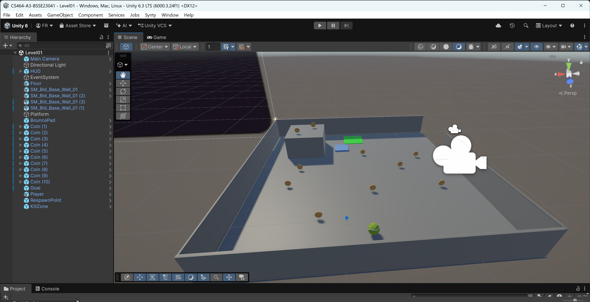
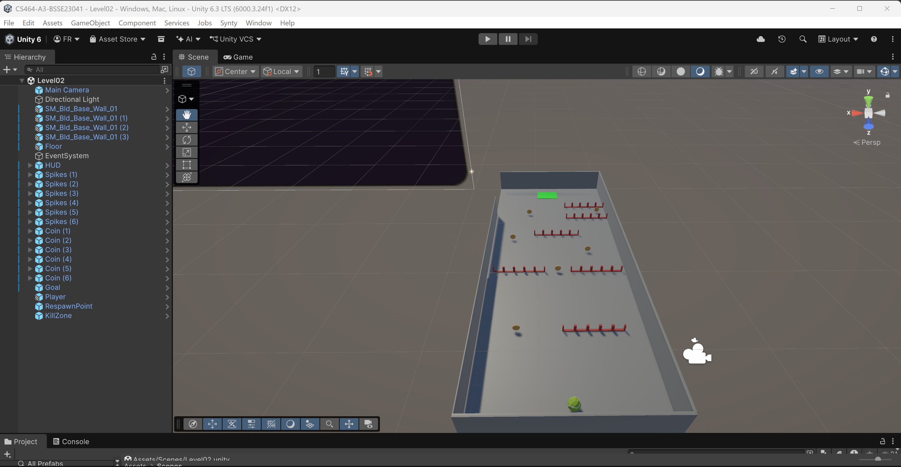
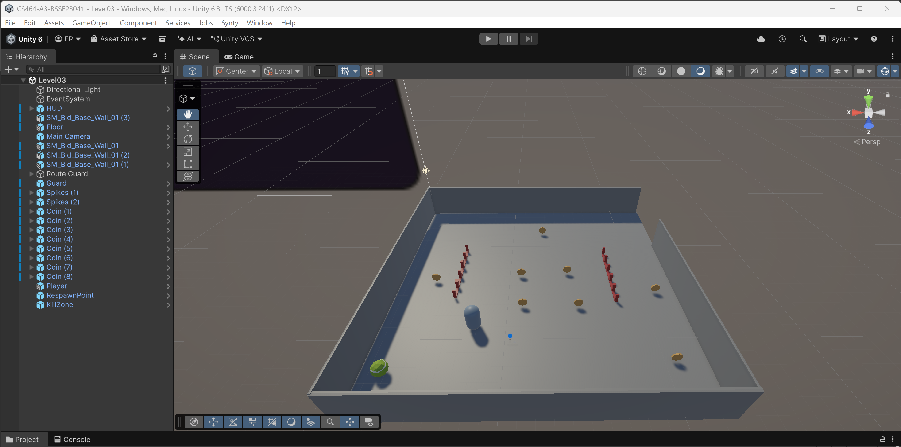
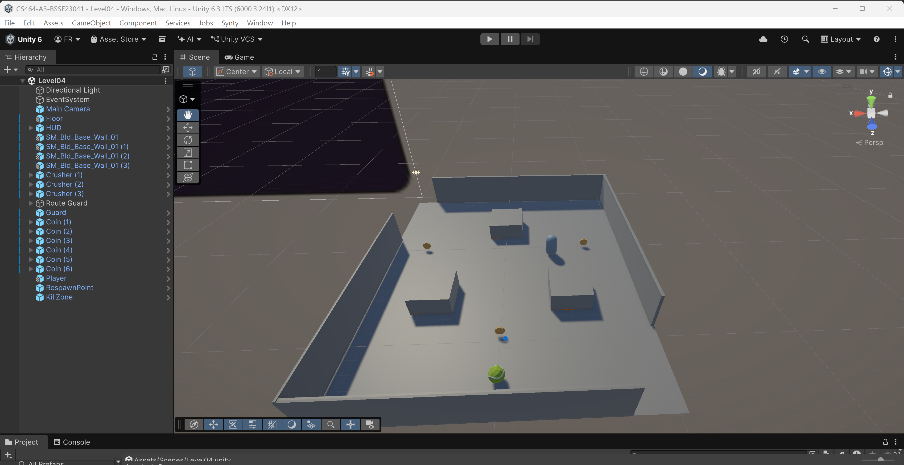
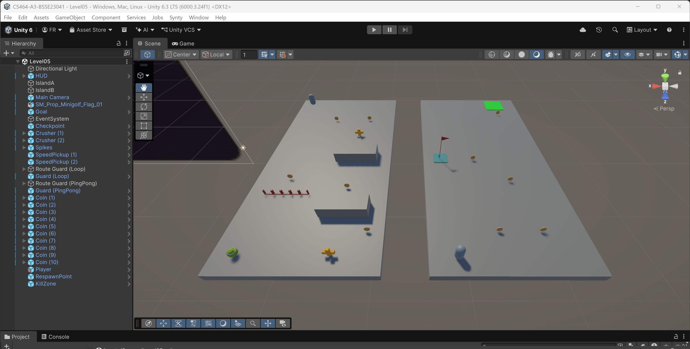

# CS464 Assignment 03 — Fasiha Rohail — BSSE23041

- **Video:** https://youtu.be/U9NuPJk1AUk
- **Started from:** I created a new repository and reused my Lab 06 work because the requirements were similar. I then changed the level layouts and added the parts needed for this assignment.
- **Controls:** W A S D or the arrow keys to move, Space to jump.
- **To win a level:** Level01: collect 10 coins, then reach the goal. Level02: collect 6 coins, then reach the goal. Level03: collect all 8 coins. Level04: collect all 6 coins. Level05: collect 10 coins, then reach the goal.

## Levels

| Level | Screenshot | New idea | Combined with |
|---|---|---|---|
| Level01 |  | Coins, a goal and a bounce pad. Two coins sit on a 3 m platform that a normal jump cannot reach, so the player needs the pad to get them. | There are no damaging obstacles yet. The only danger is falling off an open edge. |
| Level02 |  | Spikes take away one heart per hit. The first row is easy to walk around, but each following row leaves less room. | A coin on a risky detour, in a dead end between two rows of spikes. |
| Level03 |  | A guard follows a loop and chases the player when they get close. | Spikes beside the guard's route. |
| Level04 |  | Crushers rest, give a warning and then strike. Two separate crushers near the start each have a coin underneath. | A third crusher with a guard patrolling around it. |
| Level05 |  | Two speed pickups placed close enough to reach the second within the 5 s boost. | The earlier challenges come together here: spikes, two crushers, a looping guard, a ping-pong guard, a gap to jump across and a checkpoint. |

## The numbers

| Number | Value | Why this value |
|---|---|---|
| Patrol speed | 2 m/s | This is one-third of the player's movement speed of 6 m/s, making it easy to move away from a patrolling guard. |
| Chase range | 5 m (6 m for the looping guard in Level05) | In Level03, the player starts about 6 m from the guard's nearest waypoint, so the chase does not begin immediately. Level05 has a bigger, more open island, so I gave its looping guard a little more range. |
| Knockback | 6, `ForceMode.Impulse` | With the player's mass set to 1, this gives an initial 6 m/s push. Steering is disabled for 0.25 s during knockback. The reported automated test measured about 1.3 m of knockback, enough to clear the spikes; I still need to confirm this in my own play test. |
| I-frames | 1 s | The player has 1 s before they can take damage again. Since knockback lasts 0.25 s, this leaves about 0.75 s to move away after steering returns, instead of losing all three hearts immediately. |
| Power-up duration | 5 s | Five seconds gives the player time to reach the second speed pickup in Level05 before the boost ends, without keeping the boost for the whole level. The reported automated test took about 2.4 s between pickups at boosted speed; I still need to confirm this in my own play test. |
| Chase speed | 3 m/s (3.5 m/s for the looping guard in Level05) | Both are below the player's 6 m/s movement speed, so a guard can be outrun when there is room to escape. |
| Give-up range | 8 m (9 m for the looping guard in Level05) | The extra 3 m beyond the chase range prevents the guard from constantly switching between chasing and patrolling when the player is near the detection boundary. |
| Crusher warning | 0.7 s | This is longer than the 0.5 s minimum, giving the player time to notice the orange warning and step away. |
| Crusher rest | 1.8 s in Level04 and Level05 (2.4 s on the prefab) | The shorter rest time keeps the wait between strikes brief. The second crusher has an offset of 1.45 s in Level04 and 1.7 s in Level05 so the two do not strike together. |
| Bounce pad launch speed | 10 m/s, `ForceMode.VelocityChange` | This gives a theoretical rise of about 5 m (v² / 2g), enough to reach the 3 m platform in Level01. A normal jump at 7 m/s only gives a theoretical rise of about 2.5 m. |

## Short answers

**1. Why does a trigger need a Rigidbody on at least one of the two objects?**

For Unity to generate trigger events between two colliders, at least one of them needs to belong to a Rigidbody. Without one, both colliders are treated as static and do not generate trigger events with each other. In my project, the player's Rigidbody allows interactions with the coins, spikes, goal and kill zone. The guards have kinematic Rigidbodies because their movement is handled through code.

**2. Which ForceMode do your knockback and your Part A force use, and why each?**

My knockback uses `ForceMode.Impulse` in `PlayerController.Knockback()`. It suits a hit because it gives one sudden push and takes mass into account. The horizontal speed resets before the push, making it consistent whether the player was moving or standing still.

The bounce pad uses `ForceMode.VelocityChange` once in `OnTriggerEnter`. It ignores mass, so the launch speed stays the same even if the player's mass changes. Resetting the vertical speed first also stops a fall onto the pad from weakening the bounce. The launch gives a theoretical rise of about 5 m.

**3. What does your code do when a second power-up is picked up while one is running?**

The boost timer restarts. In `PlayerController.BoostSpeed()`, the existing boost coroutine stops and a new one begins. This restarts the full 5 s duration instead of adding another 5 s to the remaining time. For example, if the player collects the first pickup at 0 s and the second at 3 s, the boost ends at 8 s. The timer runs on the player, so destroying the pickup does not stop the effect.

**4. Why can `==` fail as an arrival check, and when does it work?**

Positions use floating-point numbers, so movement can leave an object slightly short of a target or take it past the target. Exact float equality can therefore miss an arrival. Unity's `Vector3 ==` uses a very small tolerance rather than exact equality, but that tolerance can still be too small for a useful arrival check.

Equality can work when movement places the object on the target, such as when `MoveTowards` reaches it and stops without overshooting. My `EnemyPatrol` code uses a distance check instead: the guard has arrived when it is within `arriveDistance` (0.15 m) of the waypoint. This gives a clear arrival margin instead of relying on equality.
